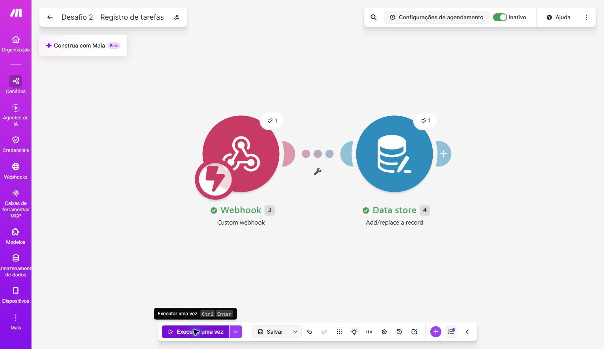
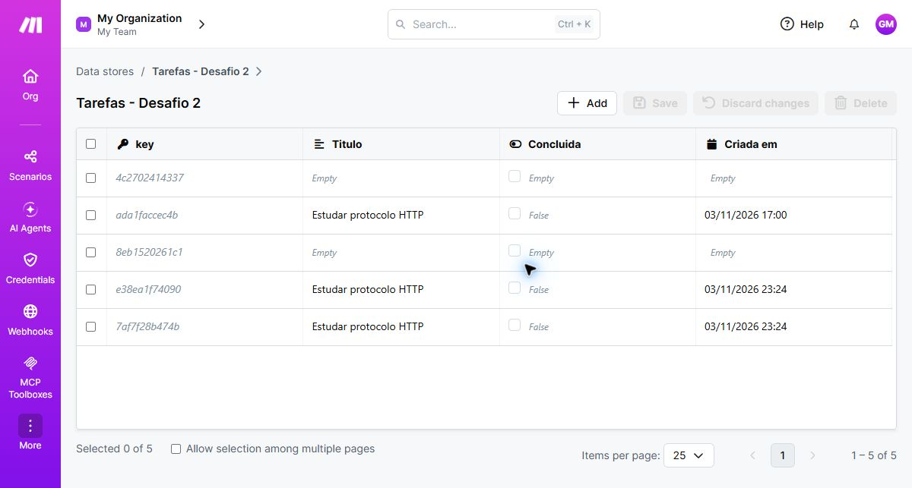

# Desafio técnico — Fidus Solutions

Consulta, criação e atualização de tarefas em JavaScript, com envio da tarefa criada para uma automação no Make.

## Arquivos

```text
desafio1.js   Programa principal
evidencias/  Prints do cenário e dos registros no Make
```

## Como executar no Windows

É necessário Node.js 18 ou superior, acesso à internet e uma URL de Custom webhook do Make. Não é necessário instalar bibliotecas.

1. Abra o PowerShell na pasta do projeto e confira a versão:

   ```powershell
   node --version
   ```

2. No Make, coloque o cenário em **Executar uma vez** para acompanhar o teste, ou deixe o cenário configurado para receber os eventos.

3. Configure a URL real somente no terminal e execute:

   ```powershell
   $env:MAKE_WEBHOOK_URL = "COLE_AQUI_A_URL_DO_SEU_WEBHOOK"
   node desafio1.js
   ```

A variável vale para a sessão atual do terminal. O programa lê essa variável diretamente; não carrega arquivos `.env`. Não publique o endereço real do webhook.

## Fluxo do programa

1. **GET** consulta cinco tarefas na API JSONPlaceholder.
2. **POST** envia uma nova tarefa à API.
3. **avisarMake(tarefa)** envia `titulo`, `concluida` e `criadaEm` ao webhook, caso a criação retorne uma tarefa.
4. **PUT** atualiza a tarefa de ID **1**, conforme o exemplo original.

O cenário usa **Custom webhook → Data store / Add/replace a record**. O segundo módulo registra os dados em “Tarefas - Desafio 2”. `criadaEm` é gerado no momento do envio, em formato ISO com horário UTC.

## Respostas e evidências

As respostas escritas (explicação do código, três melhorias propostas e diferença entre API e webhook) são entregues diretamente ao recrutador, em documento separado.

- [Cenário com os dois módulos](evidencias/01-cenario-make.jpg).
- [Resultado no Data store](evidencias/02-resultado-make.jpg).





Os prints registram uma execução dos dois módulos e tarefas com título, conclusão e data. Também aparecem registros vazios de outros testes.

## Como conferir o resultado

Após executar, confira no terminal as respostas de GET, POST e PUT e a mensagem de envio ao Make. No histórico do cenário, verifique se os dois módulos concluíram a execução e se um novo registro contém o título enviado, `concluida` igual a `false` e a data do envio. A mensagem de sucesso HTTP, sozinha, não comprova o registro no segundo módulo.

**Teste real de ponta a ponta concluído em 04/11/2026:** a versão publicada, com `MAKE_WEBHOOK_URL` configurada no terminal, executou GET, POST, envio ao webhook e PUT. O novo registro foi confirmado diretamente no Data store após atualizar a página, com os três campos esperados preenchidos.

As três melhorias apresentadas nas respostas são propostas de revisão; não foram aplicadas integralmente ao programa. O código já verifica `resposta.ok` nas requisições.
